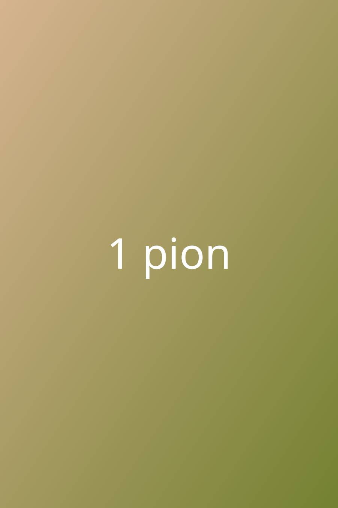
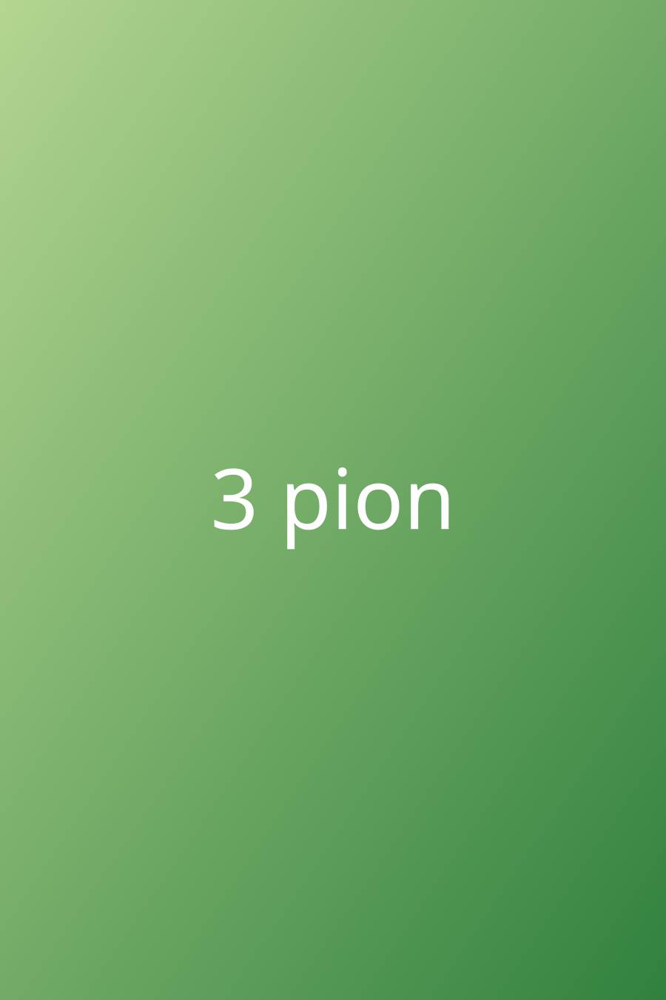
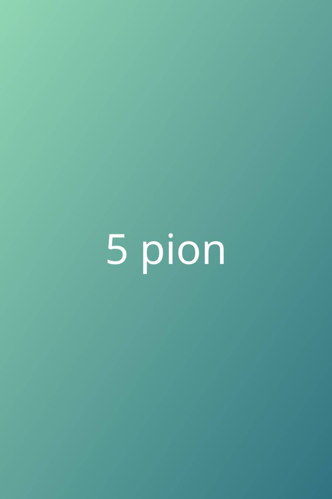
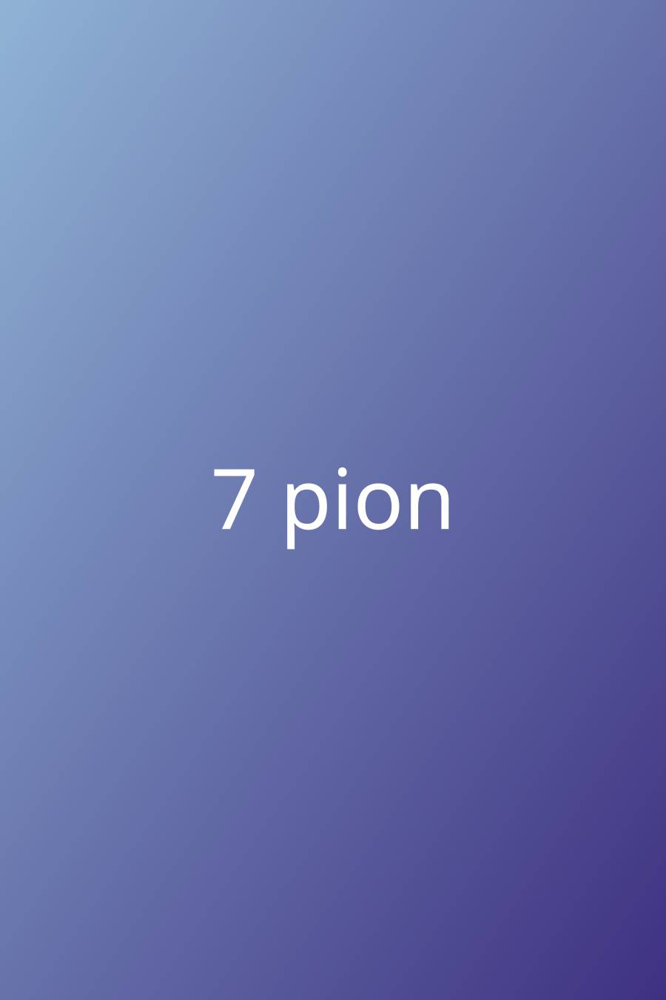
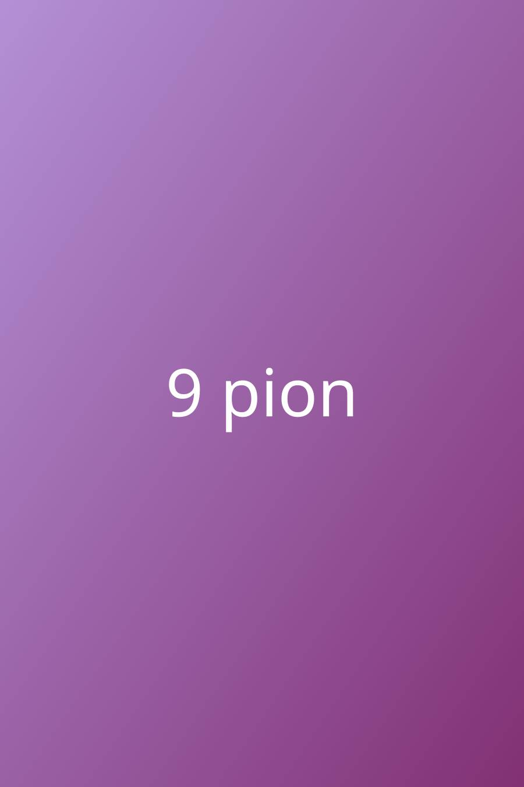

Wpis testowy (test/fixtures/blog). Okładka jest pionowa, a w treści na zmianę zdjęcia pionowe
i poziome, każde z podpisem kursywą (tak pisano wpisy w Hugo).

*Podpis zdjęcia 1 (pionowe).*

*Podpis zdjęcia 2 (poziome).*

*Podpis zdjęcia 3 (pionowe).*

*Podpis zdjęcia 4 (poziome).*

*Podpis zdjęcia 5 (pionowe).*

*Podpis zdjęcia 6 (poziome).*

*Podpis zdjęcia 7 (pionowe).*

*Podpis zdjęcia 8 (poziome).*

*Podpis zdjęcia 9 (pionowe).*

*Podpis zdjęcia 10 (poziome).*
